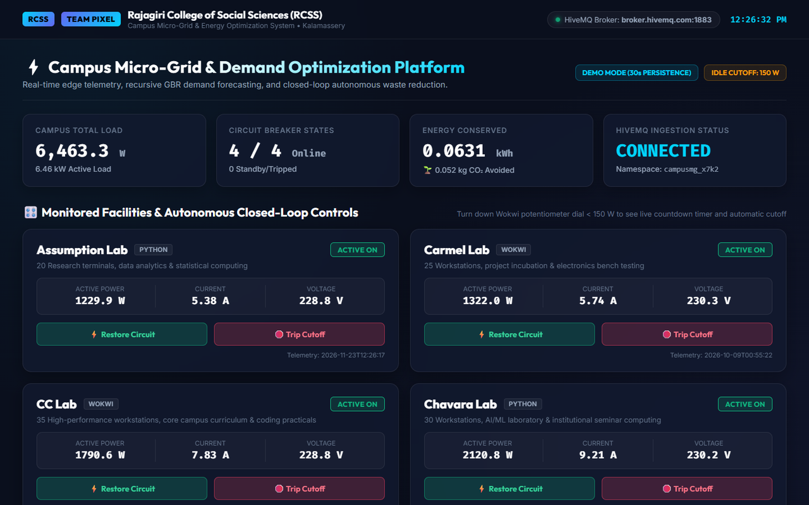
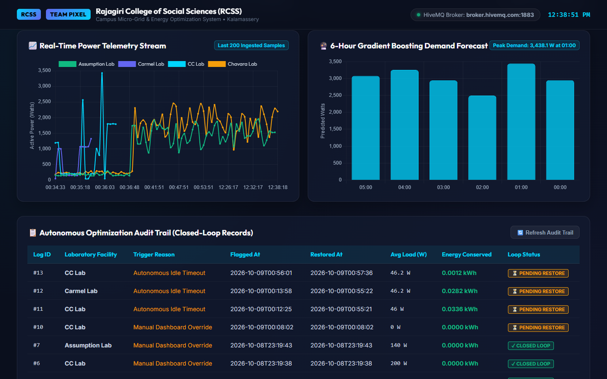
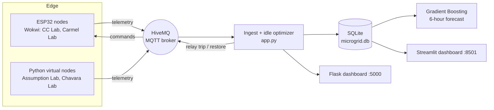

# RCSS Campus Micro-Grid & Energy Optimization System (CM-EOS)


An IoT energy-monitoring system for four computer labs at Rajagiri College (RCSS). ESP32 nodes stream voltage, current and power over **MQTT**; a Python core stores the telemetry in SQLite, **automatically trips a lab's relay after 30 s below 150 W** (idle), and uses per-lab **Gradient Boosting** models to forecast the next 6 hours of demand. Everything is shown on a live web dashboard where labs can also be switched remotely.

<p align="center"></p>
<p align="center"></p>

## Architecture



**Highlights**
- Closed-loop control: idle detection → relay cut-off command → audit log entry → restore, all over MQTT.
- One trained `GradientBoostingRegressor` per lab (`models/*.joblib`), retrainable with `forecast.py`.
- `run_all.py` bootstraps everything: generates 30 days of history if the database is missing, trains the models, and starts both dashboards.

**Team:** built by Team PIXEL (10 members); see the roster at the end.

## 🚀 Quick Start Guide (How to Run This Project)

Follow these steps to run the complete end-to-end system on your machine.

---

### Step 1: Install Dependencies

Open **PowerShell** or **Terminal** in this project folder:

```powershell
pip install -r requirements.txt
```

*(Installs `paho-mqtt`, `pandas`, `numpy`, `scikit-learn`, `streamlit`, `plotly`, `joblib`)*

---

### Step 2: Start the System

Run the master orchestrator script:

```powershell
python run_all.py
```

#### What Happens Automatically:
1. **Database & Data Check:** Verifies `data/microgrid.db`. If missing, it automatically creates 30 days of historical data.
2. **Machine Learning Check:** Verifies `models/`. If missing, it automatically trains the GBR forecasting models.
3. **Unified Microgrid Core & Modern Web Dashboard (`app.py`):** Launches the primary high-performance Flask Dashboard at **`http://localhost:5000`** with integrated multi-threaded MQTT ingestion, autonomous idle detection, and virtual edge daemons (Assumption Lab & Chavara Lab streaming every 40s).
4. **Parallel Streamlit View (`dashboard.py`):** Launches the secondary Streamlit monitoring interface at **`http://localhost:8501`**.

---

### Step 3: Start the Wokwi Hardware Simulations

Both ESP32 hardware simulations are pre-configured. Ensure the latest firmware from `wokwi/sketch.ino` is pasted into each project:

1. **CC Lab:**  
   👉 **[https://wokwi.com/projects/477333584803799041](https://wokwi.com/projects/477333584803799041)**  
   - Copy `wokwi/sketch.ino` into the Wokwi code editor (line 21: `#define LAB_CC_LAB` is active by default).
   - Click the green **Play (Start Simulation)** button.

2. **Carmel Lab:**  
   👉 **[https://wokwi.com/projects/477335176879141889](https://wokwi.com/projects/477335176879141889)**  
   - Copy `wokwi/sketch.ino` into the Wokwi code editor.
   - At line 21-22, comment `#define LAB_CC_LAB` and uncomment `//#define LAB_CARMEL_LAB`.
   - Click the green **Play (Start Simulation)** button.

Once running, the boards connect to HiveMQ (`broker.hivemq.com`), stream telemetry every 5 seconds, and listen for `SHUTDOWN` and `RESTORE` commands to physically actuate the Relay and Green LED.

---

### Step 4: Open the Modern Web Dashboard

Open your browser to the high-performance Flask Dashboard:  
👉 **`http://localhost:5000`** *(or Streamlit on `http://localhost:8501`)*

You will see:
- Real-time campus total power (~7 kW to 10 kW).
- All 4 laboratories active and streaming live telemetry.
- Ultra-smooth 1-second countdown tickers on idle cards (no page refresh locks).
- Live Chart.js telemetry line stream and 6-hour ML demand forecast bar chart.
- Instant AJAX closed-loop buttons ("Restore Circuit" & "Trip Cutoff").

---

### Step 5: How to Demonstrate the Closed-Loop Idle Cutoff & Timer

To demonstrate the automated energy saving system to evaluators:

1. **Simulate Idle Equipment:**  
   In the CC Lab (or Carmel Lab) Wokwi tab, drag the **Potentiometer dial counter-clockwise to near 0%** (simulating students leaving early or computers left unattended).
2. **Observe Live Countdown Timer on Dashboard:**  
   The active power drops below $150\text{ W}$ (e.g., ~46 W).  
   On the Dashboard at `http://localhost:5000`, that lab card immediately updates with:
   - Status badge: `⏳ SHUTTING DOWN IN 30s` (ticks down smoothly every second: **30s → 29s → 28s → ... → 0s**!).
   - Prominent alert box: **"⚠️ Equipment Unattended (46.0 W) — Going to shut down in 25s"** with a live animated gradient progress bar filling towards 100%.
3. **Watch Hardware Actuation (At 0s):**  
   Once the countdown reaches 0s, the autonomous engine triggers:
   - Dispatches `SHUTDOWN` command over MQTT topic `campusmg_x7k2/<lab>/cmd`.
   - In Wokwi: The **Relay clicks OPEN (OFF)** and the **Status LED turns OFF**.
   - On the Dashboard: The lab card switches to a red **SHUT DOWN** badge, and the event is recorded in the **Optimization Audit Trail**.
4. **Restore the Circuit (Two Ways):**  
   - **Method A (Via Physical / Simulated Meter):** Turn the **Potentiometer dial back up to Medium/High** in Wokwi (simulating students turning workstations back on). The ESP32 instantly detects demand (>500 W), automatically re-energizes the relay, turns the **Green Status LED back ON**, and signals the dashboard!
   - **Method B (Via Web Dashboard):** Click the **"⚡ Restore Circuit"** button on the dashboard. It dispatches a `RESTORE` command over MQTT to close the relay and turn the light ON.
   - The verified energy conserved (kWh) and CO₂ avoided increment in real-time in the optimization audit trail.

---

### Stopping the System

To stop all services cleanly, press **`Ctrl + C`** in the terminal where `python run_all.py` is running.

---

### ⚠️ Troubleshooting

- **MQTT Broker Connection Timeout:**  
  Some institutional / college Wi-Fi networks block unencrypted MQTT port `1883`. If the terminal shows connection retries, connect your laptop to your **mobile hotspot**.
- **Port 8501 Already in Use:**  
  If port 8501 is busy, specify an alternate port:
  ```powershell
  streamlit run dashboard.py --server.port 8502
  ```
- **Reset Everything to Fresh State:**  
  To regenerate the database and retrain the models from scratch:
  ```powershell
  python -c "import os, config, glob; os.remove(config.DB_PATH) if os.path.exists(config.DB_PATH) else None; [os.remove(f) for f in glob.glob('models/*.joblib')]"
  python backfill.py
  python forecast.py
  ```

---

### 👥 Team PIXEL &mdash; Engineering Roster
- **Devna J** &mdash; *Team Lead & System Integration*
- **Diya Mary George** &mdash; *Documentation Coordinator*
- **Jees Thomas Cleetus** &mdash; *Presentation Coordinator*
- **Ashbi Saju**
- **Rena Elza Viju** 
- **Daya Mathew**
- **Mahadevan Nair MP**
- **Kishore M**
- **Merlin Xavier**
- **Jasin Joji**
